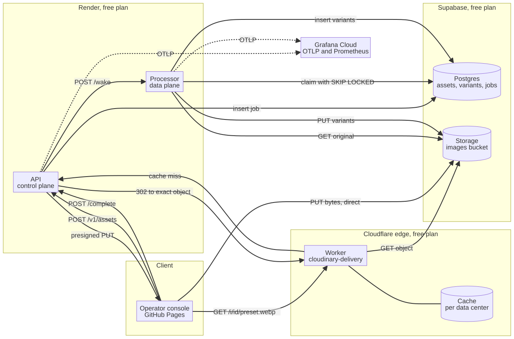
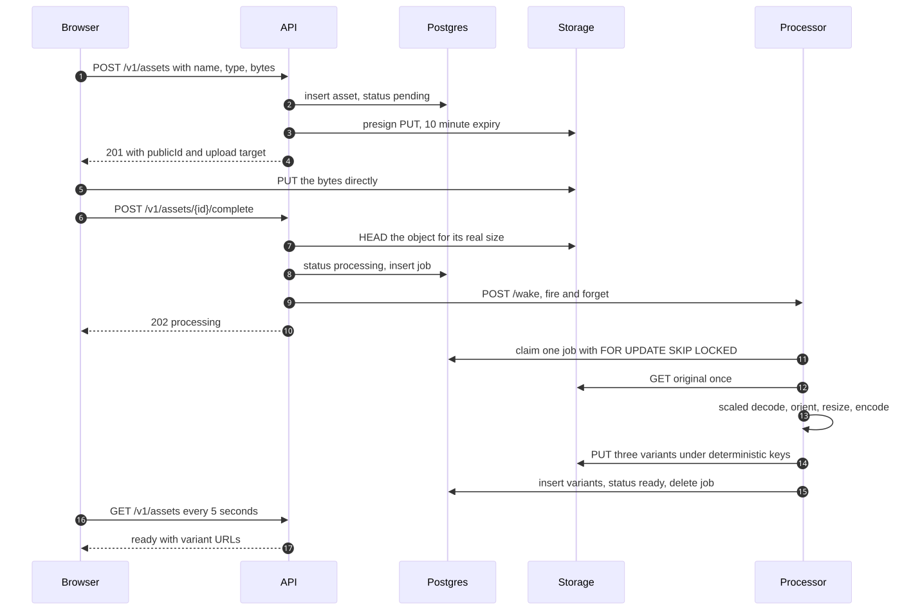
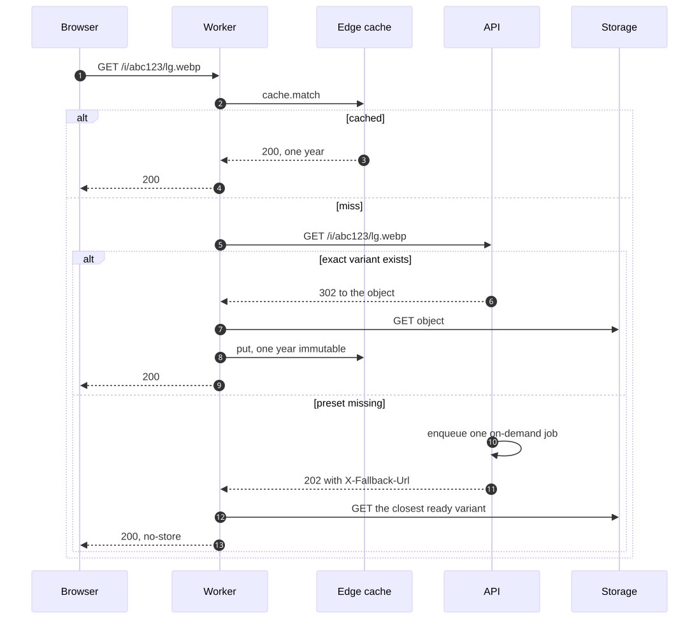
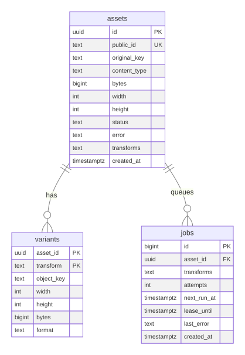
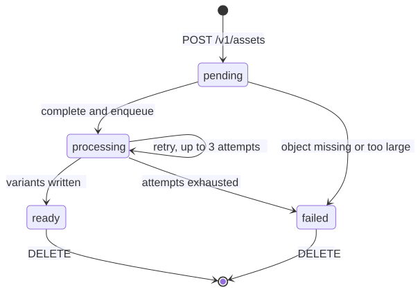

# Image service

A small Cloudinary: upload an image once, a worker writes immutable resized variants to object storage, a CDN serves them. Two .NET services, Postgres, S3-compatible storage, one Cloudflare Worker. Runs entirely on free tiers.

Scaling to a full-time, multi-tenant service: [SCALING.md](SCALING.md).

```
browser ──presign──> api ──────────────────────> postgres (assets, variants, jobs)
   │                   │                              │
   ├──PUT bytes───────>┼──> object storage             ├──claim job──> processor
   │                   │    (S3Mock / Supabase)        │                  │
   └──complete────────>┘         ▲                     │                  │
                                 └─────variants────────┼──────────────────┘
                                                       │
browser <──/i/── edge cache (cloudflare worker) <──────┘
```

## Why it is shaped this way

Free tiers do not allow request-time image work. Cloudflare Workers give 100k requests a day but 10ms of CPU per request, and serverless function bodies cap out around 4.5MB. Resizing on demand at the edge is not an option, and proxying uploads through the API is not either.

So the pipeline is:

1. The browser asks the API for a presigned PUT and uploads the bytes straight to storage.
2. The API records the asset and enqueues a job in Postgres.
3. The processor wakes, downloads once, writes every variant under a deterministic key, marks the asset ready.
4. Delivery is a redirect to an immutable object. The CDN never computes anything.

That is what makes the whole thing cost zero: compute runs once per upload, storage is write-once, and every read is cacheable forever.

## Services

| Service | Role | Scales on | Calls |
|---|---|---|---|
| `api` | control plane: presign, metadata, delivery redirects, wake the worker | requests | public |
| `processor` | data plane: decode, resize, encode, write variants | queue depth | private, `/wake` + `/health` |
| `delivery` | Cloudflare Worker: edge cache in front of `/i/` | requests | public |
| `web` | static dashboard | n/a | public |

The split is not decoration. The API is tiny and latency-sensitive. The processor is CPU-heavy, single-threaded on 512MB, and must never be publicly reachable. They share a database because they are two halves of one pipeline, not two products.

## Architecture in detail

The diagram at the top is the system in one glance. This section is the same system at the level of protocols, tables, and failure modes. Diagrams are committed as SVG, generated from the editable sources in `docs/diagrams/src`, so any client renders them without a Mermaid runtime.

The through-line is the same one Cloudinary, imgix, and every serious image service use: **compute once, write an immutable object, cache the URL forever, and never resize on the read path**. Free tiers only change the size of the machinery, not the shape of the design.

### System map



Who calls whom, and with what credential:

| From | To | Transport | Credential |
|---|---|---|---|
| Browser | API | HTTPS JSON | `X-Api-Key` |
| Browser | Storage | HTTPS PUT to a presigned URL | signature in the URL, 10 minute expiry |
| Browser | Worker | HTTPS GET/HEAD | public |
| Worker | API | HTTPS | none, delivery routes are public |
| Worker | Storage | HTTPS | none, the bucket is public for reads |
| API | Processor | HTTP POST `/wake` | `X-Internal-Key` |
| API, Processor | Postgres | Npgsql on the Supavisor pooler | database password, RLS bypassed as owner |
| API, Processor | Grafana | OTLP HTTP/protobuf | Grafana token, server side only |

The processor has no public route. Render only exposes the API and the Worker. The browser never sees a Grafana token; `/v1/metrics` is a server-side proxy.

### Upload path



Three details make this survive a 0.1 CPU worker:

- **The API never touches image bytes.** Render caps request bodies at 4.5MB and the upload cap is 20MB. Presigning moves the transfer to Supabase, so the API only writes a row and returns.
- **One download, three writes.** The processor fetches the original once, decodes it once at the largest needed size, and encodes every variant from that bitmap.
- **The job is durable before the response.** If the processor is asleep, the row sits in `jobs`; `complete` wakes it, and a crashed worker's lease expires after three minutes.

### Delivery path, including lazy presets



The public delivery surface is a **closed catalog**, not a resize API. Ten presets are generated on first request; `3xl` already exists because it matches the eager 1600 variant.

| Class | Presets | Generated |
|---|---|---|
| Eager at upload | 200 fill, 800 fit, 1600 fit | always, three objects |
| Lazy widths | `sm` `md` `lg` `xl` `2xl` `4xl` | first request |
| Lazy ratios | `thumb` `card` `hero` | first request |
| Lazy padded | `poster` | first request, white bars |
| Free by coincidence | `3xl` | already uploaded as the 1600 variant |

Fill presets accept `?g=north` and friends; any preset accepts `?u=1` to allow upscaling. Both change the canonical key, so old variants stay valid.

The fallback is deliberate. A first request must return pixels, not JSON, and it must not poison the cache. That is why the fallback is a `202` carrying `X-Fallback-Url`, and why the Worker answers it with `Cache-Control: no-store` and `CDN-Cache-Control: no-store`. The exact object is the only thing cached, for a year. An early attempt used a `302`; Workers followed it and cached the low-res fallback under the high-res URL, so the redirect was replaced.

Arbitrary transforms (`w_1234`) return 404. Existing eager variant URLs still resolve because they already exist in the database. Nothing the caller invents can enqueue compute.

### Data model



`variants` is keyed by `(asset_id, transform)`, so re-running a job upserts instead of duplicating. Both child tables cascade on delete. `transforms` is a `text[]` on purpose: one job can carry several sizes and the worker writes them in one pass.

RLS is enabled on all three tables with no policies. A Supabase anon key sees nothing; the services connect as the owner and bypass it. Delivery reads the bucket directly, so image bytes never pass through Postgres.

### Asset lifecycle



A job that fails three times is abandoned and the asset is marked `failed` with the decoder's error, which the console shows on the card and in the drawer. A retry never leaves a half-written variant behind, because keys are derived from the transform, not from time.

### How this mirrors production image services

| Concern | Industry practice | What this codebase does |
|---|---|---|
| Byte path | direct-to-object-storage uploads | presigned PUT, API stores metadata only |
| Derivative identity | content hash, immutable key | `v1/{assetId}/{sha256(canonical)[0:16]}.{ext}` |
| Transform surface | URL grammar plus named transformations | internal grammar, public closed presets |
| Compute strategy | eager common sizes, lazy long tail | three eager, ten lazy |
| Work distribution | durable queue, leased claims | Postgres `FOR UPDATE SKIP LOCKED`, 3 minute lease |
| Idempotency | overwrite the same key on retry | deterministic keys and `(asset_id, transform)` upsert |
| Backpressure | bounded queue, 429 with retry hint | depth 50, `Retry-After: 10` |
| CPU discipline | decode at target size, never upscale | Skia scaled decode, no upscale, smallest variant first |
| Read path | immutable URL, long TTL, edge cache | one year immutable, Worker cache per data center |
| Degradation | a smaller image beats a broken image | 202 fallback, `no-store`, exact object later |
| Observability | traces, metrics, usage against quota | OTLP to Grafana, `/v1/metrics` proxy, `/v1/limits` |
| Security | least privilege, private compute | API key, internal key, RLS, processor unreachable |

### Failure modes and how they degrade

| Failure | Behaviour | What the operator sees |
|---|---|---|
| API cold on Render | first request waits for the instance | health pill shows checking, then up with latency |
| Processor asleep | `complete` wakes it; the job waits in Postgres | upload row stays in processing, delivery serves fallback |
| Queue at 50 | `complete` returns 429 | upload row shows the wait from `Retry-After` |
| Object missing at complete | 409, nothing is enqueued | upload row says the object was not found |
| Object above the cap | 413 and the object is deleted | upload row says the file is too large |
| Decode failure | three attempts with backoff, then failed | error string on the card and in the drawer |
| Grafana unconfigured | `/v1/metrics` returns 503 | amber configuration notice, rest of the console works |
| Deleted image still cached | no purge on `workers.dev` | storage is freed, the old URL may serve until TTL |
| Tab hidden | polling pauses | no requests until the tab is visible again |

### What is deliberately not here

- **AVIF.** SkiaSharp does not encode it; WebP covers the same ground at this scale.
- **Cache purge.** It needs a zone, and `workers.dev` is not one. Deleted URLs may stay warm until the year expires; storage is freed immediately.
- **Signed delivery URLs.** The bucket is public for reads. A private bucket would need a signing hop in the Worker, which is a different product.
- **Multi-region, multi-tenant, per-account quotas.** One operator, one key, one bucket. The queue cap is the only quota that matters at this size.
- **Resumable uploads and WebSocket progress.** Uploads are one PUT with XHR progress; polling covers the rest.

The honest summary: this is a small system with production-shaped seams. The parts that make Cloudinary fast are here (immutable derivatives, edge caching, a closed transform catalog, a durable queue, backpressure). The parts that make it a business (purge, signed URLs, tenancy, global replication) were left out on purpose, because they either cost money or need infrastructure a free tier does not provide.

### Scaling path

The shape does not change; the size does.

| Stage | Deliveries per month | What changes |
|---|---|---|
| Today | thousands | free tiers, one worker, no purge |
| 10x | 5M | paid instances and Postgres, custom domain, purge |
| 100x | 50M | SQS, worker autoscale, origin shield, read replica |
| 1,000x | 500M | multi-AZ, partitioned variants, R2, tenancy and quotas |
| 10,000x | 5B | multi-CDN, cells, sharding, dedicated on-call |

The order is edge first, then queue and workers, then the database, then regions. Compute stays off the request path, derivatives stay immutable, and the catalog stays closed. Those are the same decisions Cloudinary-class systems run on; what changes is redundancy, tenancy, and the size of each part.

At 500M deliveries a month the math is roughly 193 average QPS, 10 origin QPS at a 95% hit ratio, 36TB of objects, and about $1,700/month with R2's free egress. The target architecture, capacity formulas, cost table, failure domains, and phased exit criteria are in [SCALING.md](SCALING.md).

## Quick start

```bash
docker compose up -d --build
```

Then open the console. For local dev: `cd web && npm install && npm run dev`, and set the api base to `http://localhost:5080` with key `dev-local-key`. The deployed console is at https://davidk4leido5.github.io/Image-Optimizer/.

Upload an image. Within a couple of seconds you get three WebP variants and a delivery URL:

```
http://localhost:5080/i/<publicId>/w_200,h_200,c_fill,f_webp,q_80.webp
```

Local storage is Adobe S3Mock. MinIO is no longer published on Docker Hub, so the compose file uses S3Mock, which accepts presigned URLs and supports CORS. It is a test double, not production storage.

### Running the services outside Docker

```bash
docker compose up -d postgres s3
dotnet run --project src/Api         # :5080
dotnet run --project src/Processor   # :5081
```

Environment variables are read from the process, not a `.env` file. Copy `.env.example` if you export them yourself.

## API

All `/v1` routes need `X-Api-Key`. Delivery routes are public.

```bash
# 1. create the asset and get an upload target
curl -s http://localhost:5080/v1/assets \
  -H 'X-Api-Key: dev-local-key' -H 'Content-Type: application/json' \
  -d '{"fileName":"cat.jpg","contentType":"image/jpeg","bytes":32876}'

# 2. PUT the file to upload.url with upload.headers, then
curl -s -X POST http://localhost:5080/v1/assets/<publicId>/complete \
  -H 'X-Api-Key: dev-local-key'

# 3. list, inspect, delete
curl -s http://localhost:5080/v1/assets -H 'X-Api-Key: dev-local-key'
curl -s -X DELETE http://localhost:5080/v1/assets/<publicId> -H 'X-Api-Key: dev-local-key'
```

Transforms are Cloudinary-flavoured: `w_400,h_300,c_fill,g_north,u_1,f_webp,q_80`. Keys are `w`, `h`, `c` (`fit`, `fill`, `pad`), `g` (crop anchor for fill: `center` by default, plus `north`, `south`, `east`, `west`, and the four corners), `u` (`1` allows upscaling, `0` or absent never upscales), `f` (`webp`, `jpeg`, `png`), `q`. Order does not matter; the canonical form is the cache identity.

The cheap version of Cloudinary's crop semantics, no saliency or face detection:

- `c_fit` keeps the whole frame and never upscales.
- `c_fill` crops to the box. Gravity picks the anchor, so `g_north` keeps the top and `g_east` keeps the right edge.
- `c_pad` fits the frame inside the box and letterboxes the rest in white.

Width presets use `fit`. `thumb`, `card`, and `hero` use `fill` with center gravity, so they are cropped by definition. `poster` uses `pad`, so it keeps the whole frame with white bars. Gravity can vary per request without opening the size catalog: `/i/<publicId>/card.webp?g=north` generates the same 480x320 box anchored to the top. The console previews the largest fit variant and only falls back to a crop when no full-frame variant exists.

By default the service never upscales. `?u=1` opts in for one request: `/i/<publicId>/card.webp?u=1` produces a real 480x320 from a 200px source, and the variant is stored under `u_1`, so older no-upscale variants keep their meaning and their cache entries. This is plain Mitchell resampling, not AI super-resolution. It makes the existing pixels larger, it cannot invent detail, and it is not sharpened.

Delivery accepts the named presets (`sm` through `hero`) plus any transform that already exists. A preset that is not ready returns `202` with `X-Fallback-Url` and `Retry-After: 2`; the Worker serves the closest ready variant with `no-store`, and the next request after generation is a `302` to the immutable object. Anything outside the catalog returns `404` and never enqueues work.

```bash
scripts/smoke.ps1    # end to end: upload, poll, fetch a variant, assert bytes
```

## How the backend stays correct

- **Deterministic keys.** `v1/{assetId}/{sha256(canonical transform)}.{ext}`. Re-running a job overwrites the same objects, so retries are idempotent and no cache purge API is needed.
- **Queue with leases.** `jobs` rows are claimed with `FOR UPDATE SKIP LOCKED` and a 3 minute lease. A crashed worker's job becomes claimable again. Three attempts, exponential backoff, then the asset is marked `failed` with the error surfaced in the dashboard.
- **Validation at the trust boundary.** Content type allowlist, size cap, magic-byte decode via `SKCodec`, 24MP decode cap, EXIF stripped.
- **Immutable caching.** Variants are written with `Cache-Control: public, max-age=31536000, immutable`.
- **One storage adapter.** The same S3 client serves local S3Mock and Supabase. Presigning uses a public endpoint, SDK calls use the internal one, which is what makes browser uploads work inside a container network.
- **Constant-time secrets.** API key and internal key comparisons hash first.

No EF Core. The schema is three tables and the queries are four joins at most; `Npgsql` plus a 40-line helper keeps cold start and dependencies smaller. Add a migration tool when a second deployable starts changing tables independently.

## Configuration

| Variable | Used by | Default |
|---|---|---|
| `DATABASE_URL` | both | local compose Postgres |
| `API_KEY` | api | `dev-local-key` |
| `INTERNAL_KEY` | both | `dev-internal-key` |
| `PROCESSOR_URL` | api | `http://localhost:5081` |
| `MAX_UPLOAD_BYTES` | api | 20 MiB |
| `S3_ENDPOINT` | both | `http://localhost:9090` |
| `S3_PUBLIC_ENDPOINT` | both | same as `S3_ENDPOINT` |
| `S3_PUBLIC_BASE` | both | same as `S3_ENDPOINT` |
| `S3_REGION`, `S3_ACCESS_KEY`, `S3_SECRET_KEY`, `S3_BUCKET` | both | local values |
| `S3_PATH_STYLE` | both | `true` |
| `OTEL_EXPORTER_OTLP_ENDPOINT` | both | unset, tracing off |

## Deploy, free, no card

Step by step, with every value and failure mode: **[DEPLOY.md](DEPLOY.md)**. The short version:

### 1. Supabase (database and storage)

1. Create a project. Create a bucket named `images` and mark it public.
2. Storage, S3 access keys: create a key pair. Endpoint is `https://<ref>.storage.supabase.co/storage/v1/s3`, region is the project region.
3. `S3_PUBLIC_BASE=https://<ref>.supabase.co/storage/v1/object/public`.
4. `DATABASE_URL`: use the pooler URI, `postgresql://postgres.<ref>:<password>@aws-0-<region>.pooler.supabase.com:6543/postgres`. The API converts URIs and pins `SslMode=Require`, `MaxPoolSize=10`.

Free project pauses after about a week idle. One scheduled ping to the REST endpoint keeps it awake.

### 2. Render (both services)

Free web services, Docker, no card. Point two services at `Dockerfile.api` and `Dockerfile.processor`, or apply `render.yaml`. Fill the env vars from above. Set `PROCESSOR_URL` to the processor's public URL.

Free plan is 750 instance hours across all services and sleeps after 15 minutes. Keep the API warm with a free pinger; let the processor sleep and wake it via `/wake`. First request after idle is slow, so the dashboard shows a waking state.

### 3. Cloudflare Worker (CDN)

```bash
cd delivery
npx wrangler deploy
```

Set `ORIGIN` in `wrangler.toml` to the API URL. No custom domain needed, which is the point: a free `workers.dev` hostname is a real HTTPS CDN endpoint.

Delivery uses a closed set of named presets, so a caller cannot invent a size:

| Preset | Size | Use |
|---|---|---|
| `sm` `md` `lg` `xl` | 320, 480, 768, 1024 wide, original ratio | `srcset` breakpoints |
| `2xl` `3xl` `4xl` | 1280, 1600, 1920 wide, original ratio | desktop |
| `thumb` | 160x160 fill | grid cells |
| `card` | 480x320 fill (3:2) | cards |
| `hero` | 1920x1080 fill (16:9) | banners |

`https://<worker>/i/<id>/lg.webp` generates on the first request and is cached for a year after. While a preset builds, the api redirects to the closest ready variant with `X-Fallback: 1`; the worker returns it with `no-store` so a low-res image is never pinned under a high-res URL. Upload still creates only the three original variants.

There is no cache purge on `workers.dev`, so a deleted asset's URL can keep returning the cached bytes until the one-year TTL or an eviction. The database row and the storage object are gone immediately, and storage does not count cached bytes against the 1 GB allowance. That is an accepted tradeoff on the free plan: purge needs a custom domain in a Cloudflare zone.

### 4. GitHub Pages (console)

The React console in `web/` deploys with the `pages` workflow. Enable it once in the repo: Settings, Pages, Source: **GitHub Actions**. After that, every push that touches `web/` builds and deploys.

In the console, set the API base to the Render URL, the key, and the CDN base to the Worker hostname.

## Budget

| Service | Free allowance | What it means here |
|---|---|---|
| Supabase storage | ~1GB, single-digit GB egress | roughly 600 to 900 assets with three variants |
| Supabase Postgres | 500MB | metadata is a few KB per asset, tens of thousands fit |
| Render | 750 instance hours, sleeps at 15 min | API warm 24/7 (~730h), processor on demand |
| Worker | 100k requests/day | cache hits skip Render, but still count as worker requests |
| GitHub Pages | free for public repos | React console, built by Actions |
| GitHub Actions | 2000 min/month private | build and test |
| Grafana Cloud | 10k series, 50GB logs | OTLP traces and metrics |

## Known limits

- 24MP decode cap, 20MB upload cap, sequential processing. One image at a time is deliberate on 512MB.
- No signed delivery URLs. Anyone with a public id can read a public asset. Add an HMAC query parameter validated in the worker when assets become private.
- One API key, no users. The API is a control plane for one operator.
- On-demand transforms are open to anyone who guesses a transform string. The worker's edge cache absorbs repeats; rate-limit at Cloudflare if that matters.
- `failed` assets keep their original object so you can retry after fixing the cause. Delete the asset to reclaim the bytes.
- SkiaSharp is MIT. ImageSharp 4 was the nicer API but requires a license key at build time, and 3.x carries known image-parser advisories, so it is not in this repo.

## Tests

```bash
dotnet test CloudinaryClone.slnx
```

43 tests: canonical transform and hashing, preset catalog uniqueness and round-trips, connection-string parsing, target-size math, fill and pad geometry, gravity, the upscale flag, EXIF orientation mapping, and WebP encoding.
