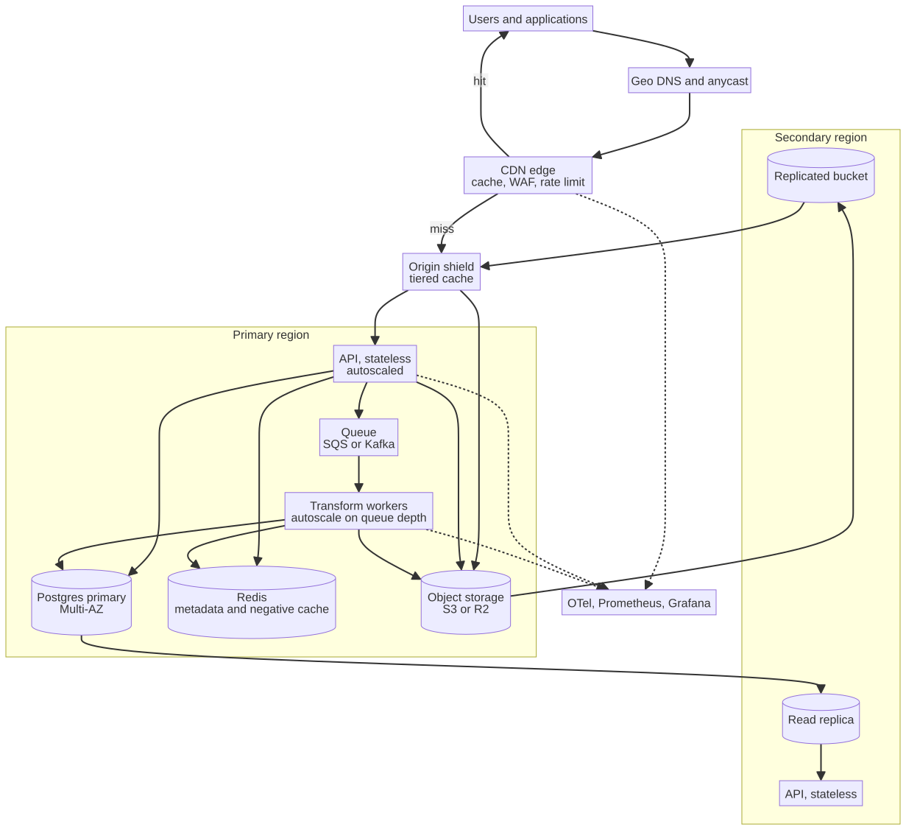

# Scaling to millions

This is the path from the free-tier deployment in this repository to a full-time, multi-tenant image service. It is a design document, not code. Every number is a planning assumption with the formula shown, not a benchmark.

The short version: the current design already has the right shape. What changes is the size and redundancy of each part, plus the business features that a free tier cannot host.

The diagram is committed as SVG, generated from `docs/diagrams/src/scaling-target.mmd`.

## What survives unchanged

These are the decisions that make the system fast at any size. They should not be replaced during scaling.

1. **Immutable derivatives.** A variant URL never changes bytes. Cache headers stay `max-age=31536000, immutable`.
2. **Compute once, read forever.** No resizing on the request path. The edge only stores and returns.
3. **A closed transform catalog.** Callers choose names, not arbitrary widths. This bounds storage, cache cardinality, and abuse.
4. **Direct-to-storage uploads.** Image bytes never pass through the API.
5. **A durable queue with bounded concurrency.** Backpressure is a feature, not a bug.
6. **Eager common sizes, lazy long tail.** Upload produces the three sizes most pages need; presets fill in on demand.
7. **A fallback instead of a broken image.** A smaller ready variant beats a 202 in an ``.
8. **Deterministic keys.** Retries are idempotent and no cleanup job is needed after a crash.

## What breaks first

Scaling is not one problem. Each order of magnitude hits a different limit.

| Stage | Deliveries per month | First thing to break | Fix |
|---|---|---|---|
| Today | thousands | Supabase 1GB, Render 750 hours, 50-deep queue | paid storage and instances, keep the code |
| 10x | 5M | one worker, Supabase free DB, no purge | paid Postgres, worker autoscale, custom domain |
| 100x | 50M | Postgres queue contention, single origin, cold cache | SQS, origin shield, read replica, Redis |
| 1,000x | 500M | single region, DB size, no tenancy, bandwidth cost | multi-AZ, partitioning, R2 or committed CDN, quotas |
| 10,000x | 5B | single CDN, blast radius, on-call load | multi-CDN, cells, sharding, dedicated SRE |

## Target architecture

Reads terminate at the edge. A miss goes through an origin shield, which collapses many edge misses into one origin request per object per region. Writes go to the API, then the queue, then a worker. Storage is the only place image bytes live.

## Layer by layer

### Edge and CDN

- Move off `workers.dev` to a custom domain in a zone you control. That alone enables purge, cache rules, WAF, and rate limiting.
- Enable **tiered cache or an origin shield**. Without it, every data center that sees a new object requests the origin once, which is the difference between 5% and 50% origin load during a launch.
- Cache key is the URL. Because the preset catalog is closed, there is no combinatorial explosion from query strings.
- Add `stale-while-revalidate` for origin hiccups. Serve stale for seconds rather than error.
- Purge by URL on delete, and purge by cache tag for bulk operations. Sign the purge calls and keep the token in a secret manager.
- Negotiate AVIF and WebP with the `Accept` header, or expose format as part of the preset name. Prefer separate URLs: `Vary` on `Accept` multiplies cache entries.
- Add signed delivery URLs (HMAC with a short TTL) when assets stop being public. The Worker verifies before hitting cache.
- Consider multi-CDN only after a single CDN's SLO is the bottleneck. Two CDNs double the purge and observability work.

### API

- Stateless containers on ECS, Cloud Run, or Kubernetes, behind an ALB or API gateway, minimum two tasks in two zones.
- Autoscale on requests per second and p95 latency, not CPU. The API is I/O bound.
- Put PgBouncer or RDS Proxy in front of Postgres. At a few hundred API tasks, connection count is the first database failure.
- Add idempotency keys to `POST /v1/assets`. A retried upload should return the same asset, not a duplicate.
- Rate limit per tenant at the edge and per key at the API. Return `429` with `Retry-After`, same as the queue cap does today.
- Keep the API's job small: metadata, presign, enqueue, redirect. Resist putting transforms back in.

### Queue

- Replace the Postgres `jobs` table with SQS (or Kafka at very high throughput). Postgres queues work well to a few hundred enqueues per second; beyond that, vacuum and lock contention start to show.
- Use two queues: `eager` for upload variants and `on-demand` for presets. When the backlog grows, shed on-demand first. An upload must finish; a new preset can wait.
- Set a visibility timeout longer than the worst transform, and a dead-letter queue after three receives.
- Keep the dedupe rule from today: one job per `(asset, transform)`. A Redis `SETNX` with a TTL, or a conditional write, prevents a page requesting eight `srcset` URLs from enqueueing eight duplicate jobs.
- Alarm on **queue age**, not depth. Depth without arrival rate is meaningless; age is what users feel.

### Processing

- Stateless workers in an autoscaling group, scaled by queue depth or age (KEDA on Kubernetes, or target tracking on ECS).
- Use spot instances. Transforms are retryable and idempotent, which is exactly what spot is for.
- libvips or sharp typically beats SkiaSharp on throughput for JPEG and WebP. Benchmark before switching; the pipeline is one decode and N encodes either way.
- Keep the CPU discipline: one decode at the largest target size, no upscale, smallest variant first, EXIF orientation applied before resize.
- Split pools by image class if needed: large originals on memory-heavy workers, thumbnails on cheap ones. A 24MP decode and a 200px thumb have different cost profiles.
- Cap concurrency per worker at the number of cores. Two 24MP decodes on one core is slower than serial.

### Storage

- S3, R2, or GCS. R2 is attractive because egress is free, and egress is the dominant cost at scale.
- Lifecycle rules: originals to infrequent access after 30 days, deep archive after a year if the product allows re-derivation. Variants stay hot.
- Replicate the bucket to a second region for disaster recovery. Versioning protects against accidental overwrite.
- Consider content-addressed originals (`sha256(bytes)`). Identical uploads then dedupe to one object, which matters for stock libraries and repeated imports.
- Use multipart and resumable uploads (`tus`) for large files. A 200MB upload over a mobile connection will not survive a single PUT.

### Metadata and Postgres

- Managed Postgres (Aurora, Cloud SQL, RDS) with Multi-AZ, point-in-time recovery, and at least one read replica.
- At 100M variants, partition by `hash(asset_id)` or by month. Keep the hot partition small and archive cold assets.
- Add Redis for asset metadata and negative caching. A 404 lookup repeated by a scraper should not reach Postgres.
- Keep the schema narrow. `variants` is already `(asset_id, transform)` with a small payload; do not add blobs.
- Backups are not a strategy without a restore drill. Test one quarterly.

### Tenancy, security, abuse

- Add accounts, API keys, quotas, and billing. The current single `API_KEY` becomes one key per tenant, hashed at rest.
- Per-tenant rate limits and storage quotas. One tenant uploading 10TB should not take down the queue for everyone.
- Validate at the trust boundary: magic bytes, decompression bombs, pixel caps, EXIF stripping. Add malware scanning and moderation for public products.
- WAF, bot management, and hotlink protection at the edge. Image services are a common target for bandwidth theft.
- Secrets in a manager (KMS, Vault, AWS Secrets Manager), rotated on a schedule. No tokens in environment variables that end up in a dashboard screenshot.

### Observability and SLOs

| Signal | Target |
|---|---|
| Edge cache hit ratio | above 90% for steady traffic |
| Edge p95 for a hit | under 100ms |
| Origin p95 for a miss | under 300ms |
| Upload success | above 99.9% |
| Queue age p95 | under 60s |
| Transform failure | below 0.5% |
| Purge propagation | under 60s |

Instrument the four golden signals per service, plus queue age, cache hit ratio, origin QPS, storage growth, and cost per thousand deliveries. Sample traces at 1% to 10%, not 100%.

## Capacity math

A worked example at 10M monthly active users, roughly 1M daily, 500M deliveries per month.

| Quantity | Formula | Result |
|---|---|---|
| Average delivery QPS | 500M / 30 / 86,400 | 193 |
| Peak delivery QPS | average x 3 | 580 |
| Origin QPS at 95% hit | 193 x 0.05 | 10 |
| Peak origin QPS | 580 x 0.05 | 29 |
| Uploads per second | 2M / 30 / 86,400 | 0.8 average, 5 peak |
| Transform jobs | 2M x 3 eager, plus 10% on demand | 6.6M per month |
| Peak transforms per second | 5 uploads x 3 variants | 15 |
| Originals | 20M x 1.5MB | 30TB |
| Variants | 100M x 60KB | 6TB |
| Database rows | 20M assets, 100M variants | about 50GB with indexes |

Sizing rules:

- **Origin QPS** = delivery QPS x (1 - hit ratio). A 99% hit ratio cuts origin load fivefold versus 95%.
- **Workers** = peak transforms per second x seconds per transform / concurrency per worker, then add 50% headroom. At 15 per second, 0.5s each, four concurrent per worker, that is two workers, deployed as four.
- **Storage** = assets x (original size + variants x average variant size). Egress, not storage, is usually the larger bill.

Cache hit sensitivity, at 193 average QPS:

| Hit ratio | Origin QPS |
|---|---|
| 90% | 19 |
| 95% | 10 |
| 99% | 2 |

That table is the argument for immutable URLs, a closed preset catalog, and an origin shield.

## Cost, order of magnitude

Rough monthly list prices for the 500M-delivery example. Treat as planning numbers, not quotes.

| Line item | Assumption | Rough monthly |
|---|---|---|
| Object storage | 36TB on R2 at $0.015/GB | $540 |
| Egress | 30TB, R2 zero egress | $0 |
| CDN requests | 500M on a paid plan | $150 to $400 |
| API and workers | 2 API tasks, 4 workers | $400 |
| Postgres Multi-AZ | 4 vCPU, 50GB | $350 |
| Redis | small, managed | $100 |
| Observability | metrics, traces, logs | $200 |
| **Total** | | **about $1,700 to $2,000** |

The same workload on S3 plus CloudFront egress at $0.085/GB adds about $2,500 for bandwidth alone. That single line is why R2 or a committed CDN contract matters more than shaving compute.

Unit economics: about $0.004 per thousand deliveries, or $0.000004 per image. The business model has room.

## Migration phases

### Phase 0, today

Free tiers, one region, one worker, no purge. Fine for a demo and a handful of users.

### Phase 1, first paying users, up to about 10k MAU

- Custom domain for the Worker, enable purge and WAF.
- Paid Render or Fly instances, Supabase Pro, automated backups.
- Add Redis and a proper metrics stack. Keep the Postgres queue.
- Exit criteria: p95 origin under 300ms, zero failed uploads for a week, restore drill passed.

### Phase 2, 100k to 1M MAU

- Move compute to ECS or Kubernetes with autoscaling.
- Replace the Postgres queue with SQS, add the DLQ and priority queues.
- Managed Postgres with a read replica; partition `variants`.
- S3 or R2 with lifecycle rules, origin shield, purge by tag.
- Exit criteria: queue age p95 under 60s during a 10x traffic spike, cache hit above 90%.

### Phase 3, millions of MAU

- Multi-region origin, read replicas, replicated buckets.
- Tenancy, quotas, billing, signed URLs, moderation.
- Cell-based isolation: a noisy tenant or a bad deploy affects one cell, not the fleet.
- Multi-CDN only if one CDN cannot meet the SLO.
- Exit criteria: regional failover tested, RTO under one hour, RPO under five minutes.

## Disaster recovery

| Property | Target |
|---|---|
| RPO for metadata | 5 minutes, PITR |
| RPO for objects | near zero with replication |
| RTO | under 1 hour |
| Queue replay | jobs are idempotent, safe to replay |

Run a game day: kill the primary database, drain a region, expire the CDN certificate, fill the queue, and confirm the fallback path still returns pixels. The current 202 fallback is the seed of that behavior.

## What not to do

- Do not resize on the request path, at the edge or in the API. The 10ms CPU limit on Workers is not a suggestion.
- Do not open the transform grammar to callers. Every arbitrary width multiplies storage and cache keys.
- Do not put image bytes through the API. Presigned uploads exist for a reason.
- Do not adopt Kafka at 2.5 messages per second. SQS is cheaper and has fewer failure modes.
- Do not shard Postgres before a single primary is saturated. Partitioning buys years; sharding buys complexity.
- Do not go multi-region before one region meets its SLO. Two broken regions are not a strategy.
- Do not purge everything on every delete. Purge by URL or tag.

## The one-line summary

Scale the edge first, then the queue and workers, then the database, and only then the regions. The parts that made this fast on a free tier, immutable derivatives, a closed catalog, direct uploads, and backpressure, are the same parts that make it fast at millions.
